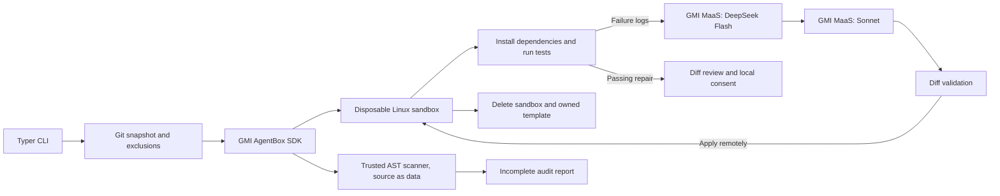

# cloudvet

[](https://github.com/dhruvil-codes/cloudvet/actions/workflows/ci.yml)
[](https://www.python.org/)
[](LICENSE)

Run a Git working tree's tests in disposable GMI AgentBox sandboxes. Diagnose failures with GMI MaaS, test a proposed repair in the sandbox, and review the diff before applying it locally. No local Docker daemon is required.

Version 0.1.0 is an initial release. Live Node, Rust and Go fixtures passed on GMI, and a Rust repair was verified end to end with DeepSeek Flash and V4-Pro. Python acceptance was blocked by a Cloudflare HTTP 403 at GMI's execution gateway during dependency installation. See [verification notes](docs/VERIFICATION.md) for the measured results and remaining acceptance gaps. GMI's reported one-second median startup is a platform benchmark, not a cloudvet guarantee. First-time template builds can take minutes.

## Install

Requires Python 3.10+, Git, a GMI account, and a compute-scoped API key. Repairs also require an inference key.

```bash
# From this repository, until the first PyPI release is published:
python -m pip install .

# After publication:
python -m pip install cloudvet

cloudvet --version
cloudvet --help
```

Use a virtual environment or `pipx install .` if your Python installation is managed by the OS. No cloud credentials are needed for help, installation, or the unit tests.

## Configure GMI Cloud

Create a compute API key in the [GMI console](https://console.gmicloud.ai). Create a separate inference key for MaaS. The keys remain in the local CLI process; cloudvet does not forward them to the sandbox.

```bash
export GMI_AGENTBOX_API_KEY="<compute key>"
export GMI_MAAS_API_KEY="<inference key>"
```

PowerShell:

```powershell
$env:GMI_AGENTBOX_API_KEY = "<compute key>"
$env:GMI_MAAS_API_KEY = "<inference key>"
```

The CLI reads the process environment. It does not load `.env` automatically. [.env.example](.env.example) lists all settings.

| Variable | Default | Purpose |
| --- | --- | --- |
| `GMI_AGENTBOX_API_KEY` | Required | AgentBox compute access |
| `GMI_MAAS_API_KEY` | `GMI_API_KEY` fallback | MaaS inference access for `fix` |
| `GMI_MAAS_BASE_URL` | `https://api.gmi-serving.com/v1` | HTTPS OpenAI-compatible inference endpoint |
| `GMI_DEFAULT_IDC` | `us-central-iowa16` | IDC for newly created templates |
| `GMI_INSTANCE_TYPE` | `gmi.sandbox.small` | Sandbox billing SKU |
| `GMI_AGENT_SLUG` | Empty | Reuse a prepared template instead of creating/deleting one per run |
| `CLOUDVET_IMAGE` | `docker.io/library/python:3.12-bookworm` | Public Linux image for new templates |
| `GMI_TRIAGE_MODEL` | `deepseek-ai/DeepSeek-V4.1-Flash` | Failure diagnosis model |
| `GMI_FIX_MODEL` | `anthropic/claude-sonnet-4.5` | Patch generation model |
| `CLOUDVET_TIMEOUT_SECONDS` | `300` | Server-enforced sandbox lifetime, 60–3600 seconds |
| `CLOUDVET_COMMAND_TIMEOUT` | `120` | Per-command wall-clock limit, shortened to fit remaining lifetime |

IDC and SKU availability vary by organization. Discover them before overriding defaults:

```python
from agentbox_sdk import AgentBoxClient

client = AgentBoxClient()
print(client.idcs.list(runtime="sandbox"))
print(client.products.list(idc_name="<returned IDC>", runtime="sandbox"))
```

Verify exact model IDs and access with your inference key. cloudvet does not silently switch models if a requested model is unavailable:

```python
import os
from openai import OpenAI

client = OpenAI(
    api_key=os.environ["GMI_MAAS_API_KEY"],
    base_url="https://api.gmi-serving.com/v1",
)
print([model.id for model in client.models.list()])
```

## Usage

Run commands from a Git repository or pass `--root`. Tracked files and non-ignored untracked files are included. Staged and unstaged changes are part of the same snapshot.

```bash
cloudvet check
cloudvet check --root ./service --json-output verdict.json
cloudvet fix
cloudvet fix src/parser.py
cloudvet fix src --yes --json-output repair.json
cloudvet audit --quick
cloudvet audit --full --output .cloudvet/review-001
cloudvet run "python --version && pytest -q"
```

`check` and `fix` install detected dependencies in the sandbox before tests. `--no-install` skips this for images that already contain dependencies. Dependency setup failures exit before invoking repair models. `run` executes only your explicit command and polls incremental stdout/stderr; it does not install dependencies automatically. Output from GMI is limited by the platform, currently 1 MiB per stream.

| Stack | Detection | Test command |
| --- | --- | --- |
| Python | `pyproject.toml`, `requirements.txt`, `setup.py` | `pytest -q` |
| Node | `package.json`, package-manager declaration and lockfiles | `npm test`, `pnpm test`, `yarn test`, or declared Vitest |
| Rust | `Cargo.toml` | `cargo test --quiet` |
| Go | `go.mod` | `go test ./...` |

Detection uses this table's order when multiple root manifests exist. It does not infer an entire monorepo. For workspaces or custom test setups, choose a project directory with `--root` or use `run`.

### Runtime images

The default image includes Python and the required Linux utilities. Node, Rust and Go projects need a public image or prepared Agent template containing their toolchain. Every image must include **bash, GNU timeout, tar and Git**. The audit scanner additionally needs Python 3.10+. Keep `/workspace` empty in prepared templates.

Examples of toolchain bases are `node:22-bookworm`, `rust:1-bookworm`, and `golang:1-bookworm`. Check their utilities and pin a suitable image digest for repeatable runs. cloudvet never builds a local Docker image. Use your registry or GMI template build to prepare an image.

For repeated runs, register a credential-free template once in GMI and set `GMI_AGENT_SLUG`. cloudvet deletes every launched sandbox but retains a user-supplied template. Fresh templates created by cloudvet are deleted after their sandbox. Template environment variables are inherited by GMI: **never select a template containing credentials, mounted production data, or privileged services**.

### Repair behavior

1. Run the detected tests in AgentBox.
2. Send a bounded failure log, working-tree diff and source inventory to DeepSeek for diagnosis.
3. Send the diagnosis and bounded source context to Sonnet for a unified git diff.
4. Validate the diff, apply it in the sandbox, and rerun the same tests. Retry at most three times.
5. Delete the sandbox. Show the verified cumulative diff and prompt `[Y/n]` before applying locally.

Only existing uploaded `.py`, `.js`, `.jsx`, `.ts`, `.tsx`, `.rs`, and `.go` source files can be patched. Repairs cannot create/delete/rename files, change modes, edit manifests, modify recognized test paths, or escape a requested scope. Names with whitespace are currently unsupported in model patches. Git checks the patch syntax and applicability. Local application refuses to overwrite files edited since upload and leaves the Git index unchanged.

A passing test suite is evidence for that suite, not proof of correctness or security. The confidence score is `1.0` for a verified passing run and `0.0` otherwise; it is a deterministic test outcome, not a calibrated probability. Review every patch, especially changes to security-sensitive behavior. A model instruction to preserve authorization is not an enforcement mechanism.

Increase the sandbox lifetime for dependency setup plus several model turns, for example `CLOUDVET_TIMEOUT_SECONDS=900`. A timed-out suite is not sent through an AI repair cycle.

`fix` prints the initial and final test verdicts with execution durations. Completed repair
attempts also print a MaaS table containing each call's model, prompt tokens and completion
tokens. These counts are provider-reported; a setup failure stops before inference.

### Terminal design

Cards fit within 80 columns, use the terminal's own background, and separate stage progress
from test verdicts. Interactive terminals get live spinners; redirected output gets static
stage lines. `NO_COLOR` is respected. Non-Unicode streams use ASCII stage markers.
Diffs have transparent highlighting, hunk headers and diff line numbers.

The executive summary reports the observed toolchain, launch-to-running time, final test
command duration, model usage and total workflow time. Hardware and dollar costs are not
invented: the default sandbox SKU is CPU-only, and exact charges require GMI billing data.

The included [Rust demo](demo_rust/) intentionally fails its zero-division test:

```bash
export CLOUDVET_IMAGE=docker.io/library/rust:1-bookworm
export GMI_FIX_MODEL=deepseek-ai/DeepSeek-V4-Pro
export CLOUDVET_TIMEOUT_SECONDS=900
cd demo_rust
cloudvet check
cloudvet fix src/lib.rs
```

The recorded live run went from `2 passed, 1 failed` to `3 passed, 0 failed` inside AgentBox.
The local-apply prompt was declined to preserve the broken demo for replay.

## Audit scope and Cloudflare attribution

The audit is a **limited defensive source review** inspired by [Cloudflare's security-audit-skill](https://github.com/cloudflare/security-audit-skill). It is independently implemented, is not affiliated with Cloudflare, and does not vendor the skill or claim compatibility with its report schema.

The current command performs a bounded Python AST scan in AgentBox. It parses source as data and never imports or executes repository code. Quick mode checks dynamic evaluation and potentially unsafe deserialization APIs; full mode also checks explicit shell invocation and disabled TLS verification. Up to four scanner workers process independent files. API aliases and data flow are not resolved, so these are review leads and may be false positives.

The report records each of the six phases, including what remains incomplete:

| Phase | Current implementation |
| --- | --- |
| 1. Reconnaissance | Source inventory; manual entrypoint and trust-boundary mapping required |
| 2. Hunting | Bounded Python syntax checks; no autonomous exploit discovery |
| 3. Validation | Check cited source locations; no generated exploit or fuzzer execution |
| 4. Structured output | Pydantic-validated `cloudvet.audit.v1` JSON |
| 5. Independent verification | Explicitly marked as not performed |
| 6. Reporting | `findings.json` and `REPORT.md` with coverage gaps |

**Dynamic adversarial validation is disabled.** The inspected AgentBox SDK exposes no outbound-deny policy. cloudvet does not substitute a process environment flag or a connectivity test for enforced isolation. It does not execute exploit probes or claim that the audit sandbox has outbound networking disabled.

All heuristic leads remain `needs_validation`. `confirmed` and `rejected` are empty unless a future reviewed implementation adds evidence-backed classification. Every report has `run_status: "incomplete"`. A report without matches does not mean the repository is secure. Node, Rust, Go, prompt injection, authorization, SSRF and memory safety are outside the implemented scanner's coverage. Parse failures, unsupported files, and file/total-size limits are recorded.

Reports use a new directory and refuse to overwrite an existing report. [docs/audit-schema.json](docs/audit-schema.json) defines cloudvet's schema.

## Data handling and cleanup

- Git selects candidate files according to its ignore rules. cloudvet additionally excludes `.git`, environment files except `.env.example`, common credential files, private key extensions, dependency directories and symlinks. The snapshot is capped at 50 MiB. Submodules and symlinks are not copied.
- Filename exclusions are not a secret scanner. Hardcoded secrets in source and logs can still reach GMI. Inspect your repository and ignore rules before use. `fix` sends code context and logs to MaaS; `check` and `run` upload the snapshot to AgentBox; `audit` sends eligible Python source to the sandbox scanner.
- Target dependency scripts and tests execute only in the cloud sandbox, where outbound internet is enabled. Do not use this version to execute deliberately malicious repositories. Provider isolation and a trusted image are prerequisites.
- Each launch sets a server lifetime. Session cleanup deletes the sandbox on success, errors and interrupts; deletion is retried three times. If deletion fails, the CLI reports it and the lifetime remains the fallback. A lost create response can leave a sandbox until its lifetime expires. Check the console after interrupted network requests.
- No idle sandboxes are intentionally retained. Model calls occur in the local CLI process, so sandbox tests never receive the CLI's API keys.
- JSON verdicts can contain source, patches and test output. Store them as sensitive build artifacts when needed.

## Architecture



## Costs and the GMI credit grant

cloudvet uses GMI for both compute and repair inference. Real usage incurs charges. It does not create artificial traffic to exhaust credits, claim spend it has not measured, or enforce an account-wide dollar budget. Set account limits and review billing in the GMI console. Repair JSON records the model IDs and provider-reported prompt/completion token counts; exact dollar totals require current rates and your account's billing records.

To use a $100 grant productively, build a real acceptance corpus of your Python, Node, Rust and Go projects, including known broken revisions. Run checks and repairs on those revisions, review patch quality, and retain JSON verdicts plus console billing exports. Continue legitimate regression work toward a $50 monthly target only while it is useful and within your account budget. The grant's scope, model eligibility and compute eligibility must be confirmed with GMI. No $50 consumption claim has been made for this release.

See GMI's [SDK reference](https://docs.gmicloud.ai/agentbox-sdk/python-reference), [inference API](https://docs.gmicloud.ai/inference-engine/api-reference/llm-api-reference), and [pricing page](https://docs.gmicloud.ai/inference-engine/billing/price). Startup and example billing figures come from [GMI's AgentBox v2 benchmark](https://www.gmicloud.ai/en/blog/agentbox-v2-one-agent-ran-47-trending-github-repos-in-47-sandboxes); use your console's current prices for estimates.

## Development and release

```bash
python -m venv .venv
# Activate the environment for your shell, then:
python -m pip install -e '.[dev]'
pytest -q
ruff check .
ruff format --check .
python -m build
python -m twine check dist/*
```

Tests mock GMI APIs; they do not spend credits. Tests also use real temporary Git repositories and execute the trusted audit scanner as a subprocess, without running target code. CI checks Python 3.10–3.13 on Linux and Python 3.10 on Windows, builds the wheel/sdist, and installs the wheel to check its entrypoint.

The manual PyPI release workflow uses GitHub trusted publishing and the `pypi` environment. Configure the PyPI project publisher for this repository and `publish.yml`, review artifacts and live acceptance evidence, then dispatch it. Publication is not automatic on push. See [docs/RELEASE.md](docs/RELEASE.md).

An explicit billable acceptance runner creates small fixture repositories and cleans up their sandboxes:

```bash
export GMI_FIX_MODEL="deepseek-ai/DeepSeek-V4-Pro" # If Sonnet is unavailable to your account
export CLOUDVET_TIMEOUT_SECONDS=900
python tests/live_acceptance.py --stack all --heal --output .cloudvet/live-acceptance
```

This runner is excluded from pytest collection. Its Python fixture intentionally fails before repair. `acceptance.json` records actual results and provider token usage; it never certifies a repair when cloud verification fails. Use a new output directory for each run.

Exit codes: `check`/`fix` use `0` for success, `1` for failed tests or an unverified repair, and `2` for setup/service errors. `audit` uses `1` for review leads and `0` for no heuristic matches, while its report is always explicitly incomplete. `run` propagates the command's exit code, including timeout `124`, unless setup fails with `2`. Interrupts use `130`.

## License

Apache-2.0. See [LICENSE](LICENSE).
